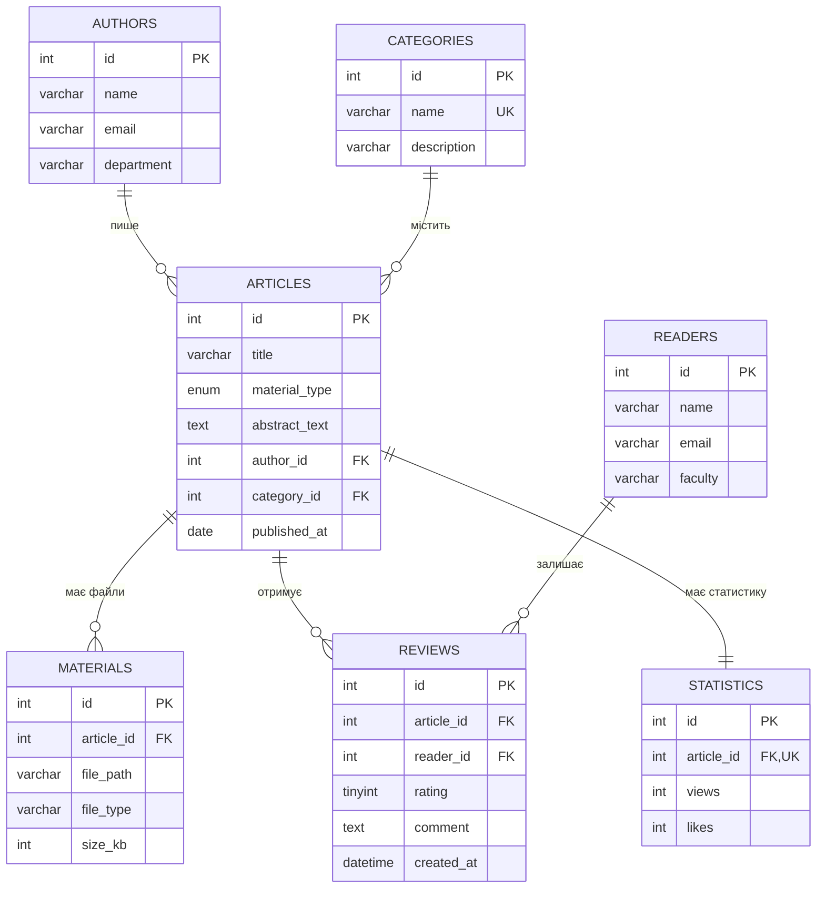

# Мережева газета факультету

Інформаційна система факультетської мережевої газети на **Haskell + MySQL**.

У роботі використано **типові класи (type classes)** та **екземпляри (instances)**:
універсальний шар доступу до даних описано класами `Entity` і `Repository`,
а кожна таблиця отримує CRUD-поведінку через `instance`.

---

## 1. Що вміє програма

- ведення авторів, категорій, статей/графічних/відеоматеріалів;
- облік файлів публікацій (html, pdf, jpg, mp4 тощо);
- ведення читачів та їхніх відгуків з оцінкою 1–10;
- статистика переглядів і вподобань для кожного матеріалу;
- додавання, перегляд, редагування та видалення записів у всіх таблицях;
- пошук статей за назвою або анотацією;
- аналітичні звіти:
  - топ-10 матеріалів за переглядами;
  - середній рейтинг публікацій;
  - кількість публікацій за авторами та категоріями;
  - активність читачів;
  - публікації без файлів.

Кількість таблиць — **7**.

---

## 2. Структура бази даних

```
authors 1 ──── * articles * ──── 1 categories
                    │
                    ├── * materials      (файли публікації)
                    ├── * reviews * ──── 1 readers
                    └── 1 statistics     (views, likes)
```

| Таблиця | Призначення | Основні поля |
|---|---|---|
| `authors` | автори публікацій | `id`, `name`, `email`, `department` |
| `categories` | рубрики газети | `id`, `name`, `description` |
| `articles` | статті, графіка, відео | `id`, `title`, `material_type`, `abstract_text`, `author_id`, `category_id`, `published_at` |
| `materials` | файли публікацій | `id`, `article_id`, `file_path`, `file_type`, `size_kb` |
| `readers` | читачі | `id`, `name`, `email`, `faculty` |
| `reviews` | відгуки читачів | `id`, `article_id`, `reader_id`, `rating`, `comment`, `created_at` |
| `statistics` | статистика матеріалів | `id`, `article_id`, `views`, `likes` |

Зв’язки:

- `articles.author_id → authors.id` (`ON DELETE RESTRICT`);
- `articles.category_id → categories.id` (`ON DELETE RESTRICT`);
- `materials.article_id → articles.id` (`ON DELETE CASCADE`);
- `reviews.article_id → articles.id` (`ON DELETE CASCADE`);
- `reviews.reader_id → readers.id` (`ON DELETE CASCADE`);
- `statistics.article_id → articles.id` (`ON DELETE CASCADE`, `UNIQUE`).

Повна схема: [`sql/schema.sql`](sql/schema.sql).
Демонстраційні дані: [`sql/seed.sql`](sql/seed.sql).
Приклади запитів: [`sql/queries.sql`](sql/queries.sql).

### 2.1. ER-модель



---

## 3. Архітектура Haskell-коду

```
app/Main.hs                 — точка входу
src/Newspaper/Types.hs      — моделі предметної області
src/Newspaper/Entity.hs     — класи Entity, Repository та instances
src/Newspaper/Db.hs         — підключення, створення схеми, seed
src/Newspaper/Queries.hs    — SQL-запити для карток і звітів
src/Newspaper/Cli.hs        — консольне меню та CRUD-сценарії
```

### 3.1. Клас `Entity`

`Entity` описує метадані таблиці та перетворення Haskell-запису в SQL-параметри:

```haskell
class QueryResults a => Entity a where
    entityTitle       :: Proxy a -> String
    tableName         :: Proxy a -> String
    idColumn          :: Proxy a -> String
    entityId          :: a -> Maybe Int
    setEntityId       :: Int -> a -> a
    entityLabel       :: a -> String
    selectColumns     :: Proxy a -> [String]
    insertColumns     :: Proxy a -> [String]
    insertActions     :: a -> [Action]
    updateAssignments :: Proxy a -> [String]
    updateActions     :: a -> [Action]
    ...
```

На основі цих методів клас будує SQL-запити за замовчуванням
(`selectAllQuery`, `selectByIdQuery`, `insertQuery`, `updateQuery`,
`deleteQuery`). Тому в екземплярах не потрібно повторювати однаковий SQL.

Приклад екземпляра для таблиці `articles`:

```haskell
instance Entity Article where
    entityTitle _ = "стаття/матеріал"
    tableName _ = "articles"
    idColumn _ = "id"
    entityId = articleId
    setEntityId ident article = article { articleId = Just ident }
    entityLabel = T.unpack . articleTitle
    selectColumns _ =
        [ "id", "title", "material_type", "abstract_text"
        , "author_id", "category_id", "published_at"
        ]
    insertColumns _ =
        [ "title", "material_type", "abstract_text"
        , "author_id", "category_id", "published_at"
        ]
    insertActions article =
        [ render (articleTitle article)
        , render (materialTypeToDb (articleType article))
        , render (articleAbstract article)
        , render (articleAuthorId article)
        , render (articleCategoryId article)
        , render (articlePublishedAt article)
        ]
    updateAssignments _ =
        [ "title = ?", "material_type = ?", "abstract_text = ?"
        , "author_id = ?", "category_id = ?", "published_at = ?"
        ]
    updateActions article =
        [ render (articleTitle article)
        , render (materialTypeToDb (articleType article))
        , render (articleAbstract article)
        , render (articleAuthorId article)
        , render (articleCategoryId article)
        , render (articlePublishedAt article)
        ]
```

### 3.2. Клас `Repository`

`Repository` надає універсальні CRUD-операції з реалізацією за замовчуванням:

```haskell
class Entity a => Repository a where
    listAll      :: Connection -> IO [a]
    findById     :: Connection -> Int -> IO (Maybe a)
    create       :: Connection -> a -> IO Int
    updateEntity :: Connection -> a -> IO Bool
    deleteEntity :: Connection -> a -> IO Bool
    saveEntity   :: Connection -> a -> IO Int
```

Екземпляри виглядають гранично коротко:

```haskell
instance Repository Author
instance Repository Category
instance Repository Article
instance Repository Material
instance Repository Reader
instance Repository Review
instance Repository Statistic
```

Саме це демонструє поліморфізм на рівні типових класів: один і той самий
`create`/`updateEntity`/`findById` працює для всіх семи сутностей.

### 3.3. `QueryResults` та `Params`

- `QueryResults` — клас mysql-simple для перетворення рядка MySQL у запис.
  Для кожного типу (`Author`, `Article`, ...) написано окремий `instance`:

```haskell
instance QueryResults Author where
    convertResults [fId, fName, fEmail, fDept] [vId, vName, vEmail, vDept] =
        Author (convert fId vId)
               (convert fName vName)
               (convert fEmail vEmail)
               (convert fDept vDept)
    convertResults fields values = convertError fields values 4
```

- `Params` — обгортка над `[Action]`, яка дозволяє передавати довільну
  кількість параметрів у `INSERT`/`UPDATE`. Стандартні екземпляри
  `QueryParams` у mysql-simple існують лише для кортежів фіксованої арності:

```haskell
newtype Params = Params [Action]

instance QueryParams Params where
    renderParams (Params actions) = actions
```

### 3.4. Тип `MaterialType`

Тип матеріалу зберігається в MySQL як `ENUM('article','graphic','video')`,
а в Haskell представлений окремим типом:

```haskell
data MaterialType = TextMaterial | GraphicMaterial | VideoMaterial
```

Перетворення виконують функції `materialTypeToDb`, `materialTypeFromDb`,
`materialTypeLabel`, `parseMaterialType`.

---

## 4. Запуск

### 4.1. Автоматичний режим (рекомендовано)

Програма сама створює базу `faculty_newspaper`, таблиці та демонстраційні
дані, якщо їх ще немає:

```bash
cd func_progr_lab1
cabal build
cabal run faculty-newspaper
```

За замовчуванням використовується підключення:

```
host=localhost port=3306 user=root password='' database=faculty_newspaper
```

Параметри можна змінити змінними середовища:

```bash
export NEWSPAPER_DB_HOST=localhost
export NEWSPAPER_DB_PORT=3306
export NEWSPAPER_DB_USER=root
export NEWSPAPER_DB_PASSWORD='my-password'
export NEWSPAPER_DB_NAME=faculty_newspaper
cabal run faculty-newspaper
```

---

## 5. Висновки

У ході лабораторної роботи розроблено інформаційну систему «Мережева газета
факультету» на Haskell з використанням MySQL. Реалізовано 7 таблиць, пов’язаних
зовнішніми ключами, та повний набір CRUD-операцій.

Основну увагу приділено типовим класам:

- `Entity` — описує метадані таблиці та будує SQL-запити;
- `Repository` — надає універсальні CRUD-операції;
- `QueryResults` — перетворює рядки MySQL у Haskell-записи.

Завдяки екземплярам (`instance`) для семи сутностей вдалося уникнути
дублювання коду: одна реалізація `create`/`updateEntity`/`findById` працює
для всіх таблиць. Програма забезпечує додавання, коригування, видалення,
пошук і аналітичні звіти, а також коректно обробляє помилки зовнішніх ключів.
